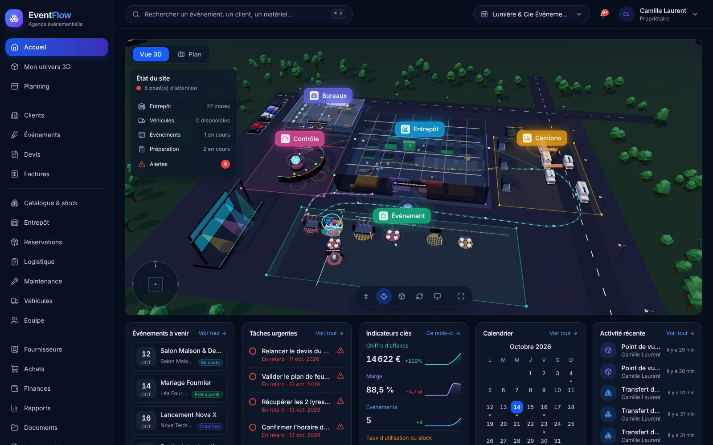
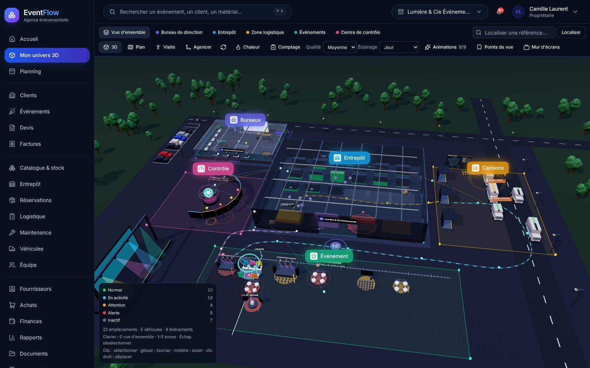
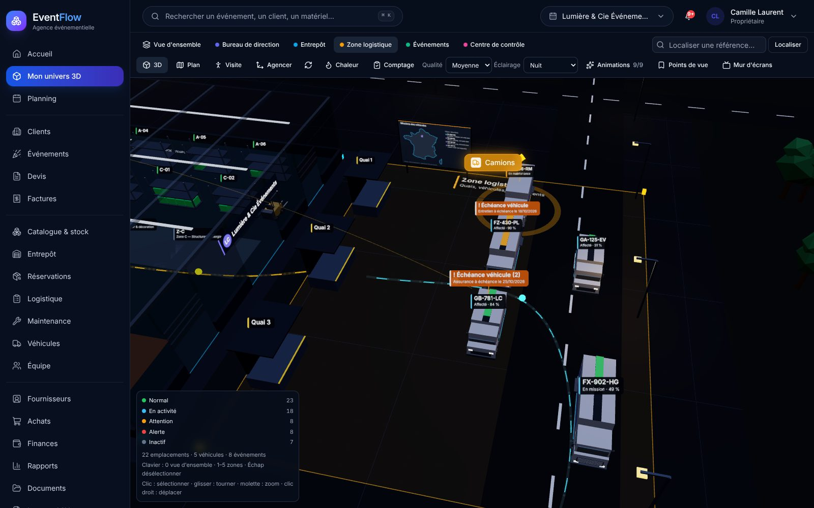
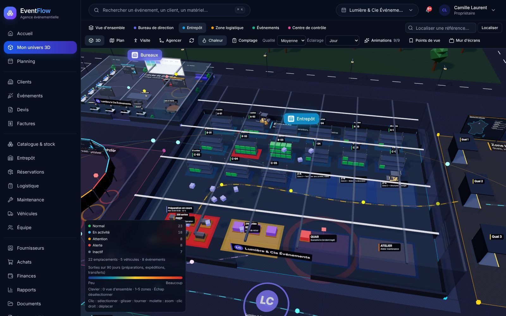
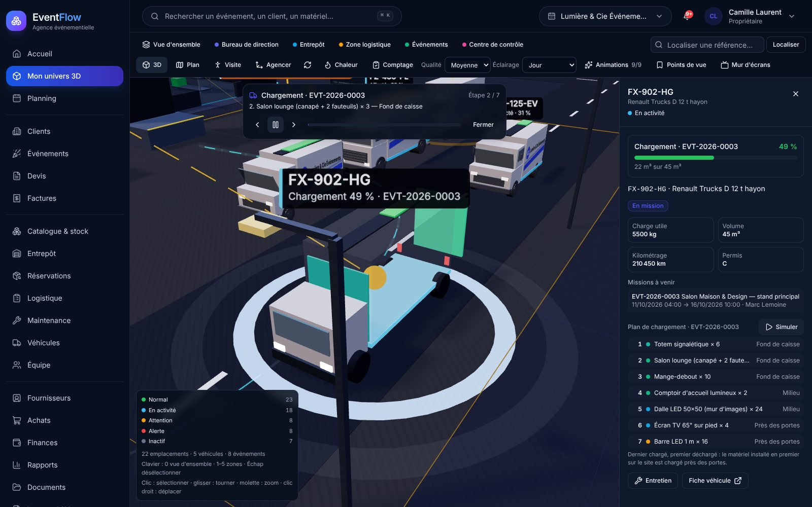
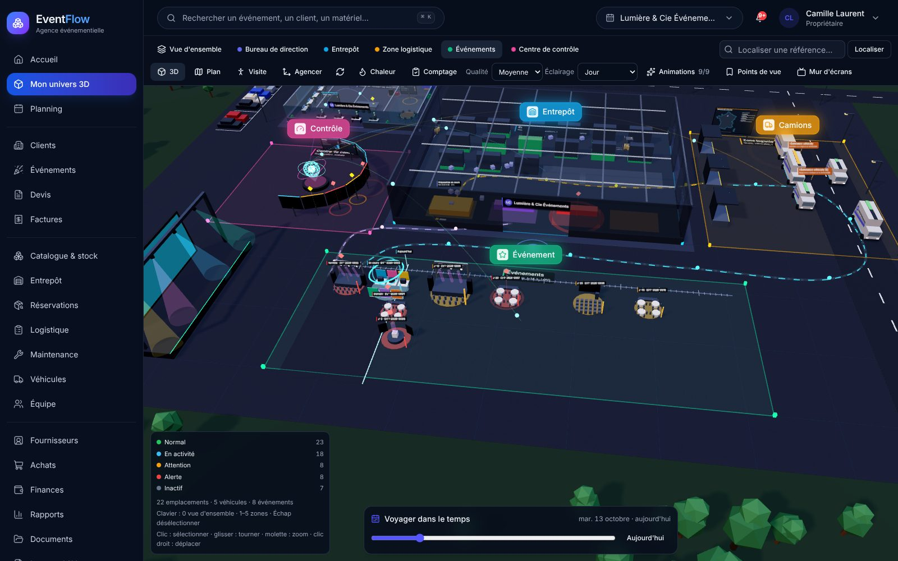
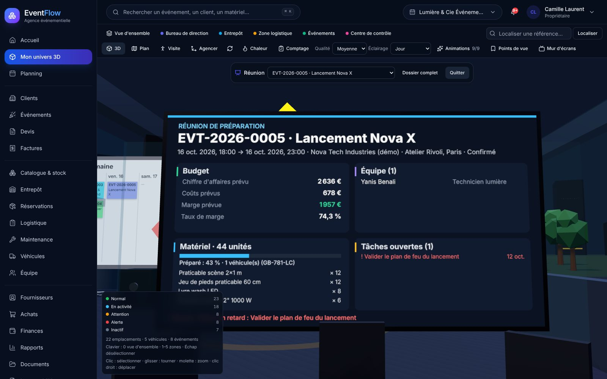
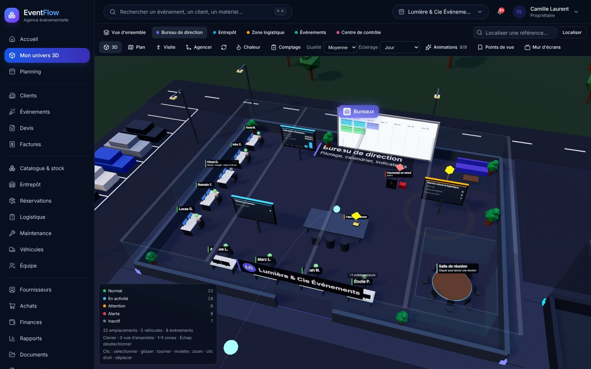

<div align="center">

# EventFlow 3D

**L'ERP/CRM des agences événementielles, avec un jumeau numérique 3D de l'activité.**

Clients · Événements · Stock en temps réel · Logistique · Véhicules · Équipes · Devis & factures · Rentabilité · Monde 3D


[Captures](#-captures-décran) · [Fonctionnalités](#-fonctionnalités) · [Démarrage rapide](#-démarrage-rapide) · [Architecture](#-architecture) · [Sécurité](#-sécurité) · [Tests](#-tests) · [Documentation](#-documentation) · [Roadmap](ROADMAP.md)

</div>

---

## Pourquoi EventFlow 3D ?

Une agence événementielle jongle chaque semaine avec des centaines de références de matériel,
des événements qui se chevauchent, des camions, des techniciens et des devis à transformer en
factures. Les tableurs et les outils séparés provoquent des **doubles réservations**, du
**matériel perdu** et des **marges inconnues**.

EventFlow 3D réunit tout le cycle dans un seul outil :

```
Client → Devis → Événement → Réservation → Préparation → Départ → Retour → Facture → Rentabilité
```

…et le rend **visible** : l'entrepôt, les bureaux, les quais, les véhicules et les événements sont
représentés dans un monde 3D relié aux données réelles, intégré dès la page d'accueil. Cliquer sur
un rayonnage montre son contenu exact ; cliquer sur un camion montre son chargement et sa mission ;
s'asseoir à la table de réunion affiche le dossier complet d'un événement.

> **Statut** : version fonctionnelle complète, testée (intégration + navigateur), non encore
> déployée en production. Voir [PROGRESS.md](PROGRESS.md) pour l'état précis et les limites.

## 📸 Captures d'écran

> Captures réalisées sur les données de démonstration (`npm run db:seed`).

**Accueil** — indicateurs du jour, monde 3D intégré, alertes et activité récente.



**Monde 3D** — l'entrepôt, les bureaux, les quais et les véhicules reliés aux données réelles.



<table>
  <tr>
    <td width="50%"><br /><sub><b>Logistique, de nuit</b> — flux de matériel, véhicules en mission et éclairage jour/nuit.</sub></td>
    <td width="50%"><br /><sub><b>Carte de chaleur</b> — sorties des 90 derniers jours par emplacement.</sub></td>
  </tr>
  <tr>
    <td width="50%"><br /><sub><b>Simulation de chargement</b> — plan de chargement pas à pas d'un camion (dernier chargé, premier déchargé).</sub></td>
    <td width="50%"><br /><sub><b>Zone événements</b> — frise des événements à venir et « voyager dans le temps ».</sub></td>
  </tr>
  <tr>
    <td width="50%"><br /><sub><b>Salle de réunion</b> — le dossier complet d'un événement autour de la table.</sub></td>
    <td width="50%"><br /><sub><b>Bureau de direction</b> — postes de l'équipe (absences, présence), écrans d'indicateurs et calendrier.</sub></td>
  </tr>
</table>

## ✨ Fonctionnalités

| Domaine | Ce que fait EventFlow 3D |
|---|---|
| **CRM** | Clients entreprises et particuliers, contacts, adresses, historique, documents, archivage, recherche ; fournisseurs |
| **Événements** | Fiche complète (lieu, horaires, montage/démontage, fuseau horaire), statuts, tâches, notes, équipe, véhicules, dépenses, calendrier |
| **Catalogue & stock** | Références, catégories, unités sérialisées, photos, emplacements hiérarchiques (rack, case, quarantaine…), inventaires, seuils d'alerte |
| **Disponibilité temporelle** | Calcul du disponible **sur une période** (pic d'utilisation, tampons de préparation et de retour), conflits affichés en direct |
| **Réservations** | Confirmation **sûre en concurrence** (aucune sur-réservation possible), préparation, expédition, retours partiels, casse, pertes, historique complet |
| **Logistique** | Tableau de bord des départs/retours, bons de préparation, de livraison et de retour en PDF |
| **Maintenance** | Tickets automatiques au retour endommagé, quarantaine, atelier, réparation ou rebut |
| **Achats** | Commandes fournisseurs, réceptions partielles (le stock n'augmente qu'à la réception) |
| **Véhicules** | Fiches, échéances (entretien, contrôle, assurance), affectations avec contrôle des conflits, permis et charge utile |
| **Équipes** | Compétences, disponibilités, affectations sans chevauchement, coûts horaires, relevés d'heures, planning, **portail freelances & intermittents** (propositions de mission à accepter en ligne, disponibilités) |
| **Devis & factures** | Lignes éditables, remises, TVA multi-taux, versions de devis, factures **immuables** après émission, avoirs, paiements partiels, PDF |
| **Finance** | Rentabilité prévue/réelle par événement, synthèses par période, séries mensuelles, 9 rapports filtrables exportables |
| **Pilotage** | Accueil « cockpit » : vue 3D du site, événements à venir, tâches urgentes, indicateurs clés avec courbes, calendrier, activité récente ; blocs personnalisables, notifications, recherche globale `Ctrl/⌘ K` |
| **Données** | Import CSV avec aperçu et rapport d'erreurs, exports CSV sécurisés, documents avec contrôle des droits |
| **Monde 3D** | Jumeau numérique du site relié aux données réelles : entrepôt, bureaux, logistique, frise des événements, centre de contrôle ; panneau contextuel et actions métier, visite à pied, mur d'écrans, présence des collègues, **plan 2D de secours** (détails ci-dessous) |
| **Organisation** | Multi-organisation, 11 rôles, 45 permissions personnalisables, journal d'audit, invitations |

### Le monde 3D, en pratique

Page **Mon univers 3D** (`/world`), vue intégrée à l'accueil et **mur d'écrans** (`/wall`, rotation
automatique entre les zones pour une TV de l'agence).

| Espace | Ce qu'on y voit (données réelles) |
|---|---|
| **Entrepôt** | Rayonnages remplis selon le stock, alertes de stock bas, **chemin GPS** vers une référence recherchée, carte de chaleur des sorties (90 j), inventaire tournant du jour, préparations en cours animées, chariots élévateurs actifs selon les mouvements du jour |
| **Logistique** | Véhicules (modèles 3D détaillés) avec taux de chargement, échéances (assurance, contrôle technique, entretien), **simulation de chargement** « dernier chargé, premier déchargé », carte des missions en France |
| **Événements** | Frise J-14 → J+60 avec maquettes par type d'événement (scène, banquet, salon, conférence…) à l'échelle des invités, comptes à rebours, liens vers le matériel et les véhicules |
| **Bureaux** | Un poste par collaborateur (au bureau, en mission, absent), planning de la semaine en post-its, écrans à graphiques cliquables, **salle de réunion** (dossier budget / équipe / matériel / tâches), courrier des devis à relancer, pile des factures en retard |
| **Centre de contrôle** | Écrans d'indicateurs de chaque module, arcs de supervision |

**Outils** : visite à pied (ZQSD, collisions), **points de vue enregistrés** partagés avec l'équipe
et liens `?view=…`, présence des collègues connectés, agencement (rotation, aimantation, annulation,
duplication de rayonnage, **historique des versions** avec restauration), raccourcis clavier
(`0` vue d'ensemble, `1`–`5` zones, `Échap`).

**Rendu** : bâtiments vus en coupe, abords (parking, voiries, arbres), **cycle jour/nuit** selon
l'heure réelle du site, thème clair/sombre de l'application, habillage aux couleurs de l'agence,
ombres, halo lumineux. Réglages **Qualité** (basse / moyenne / élevée, dégradation automatique si
la machine peine), **Éclairage** (heure réelle / jour / nuit) et **Animations** (chacune peut être
masquée ou figée), mémorisés dans le navigateur ; le réglage système « réduire les animations » est respecté.

**Principes** :

- Chaque objet porte une **identité métier explicite** (`STOCK_LOCATION:…`, `VEHICLE:…`) : rien
  n'est déduit de sa position.
- Le panneau contextuel lit les données réelles via l'API ; les actions (transfert de stock,
  statut d'un véhicule, mise en maintenance) passent par les **mêmes règles serveur** que les
  écrans classiques. Aucun composant 3D n'écrit directement en base.
- Accessibilité : chaque objet est atteignable au clavier (`Tab`, `Entrée`) et annoncé aux lecteurs
  d'écran. Sans WebGL (ou en cas d'erreur graphique), l'application bascule automatiquement sur un
  plan 2D accessible : aucune fonctionnalité n'est perdue.
- Aucune ressource externe : modèles 3D générés par le projet (`npm run models:build`, compression
  Meshopt), géographie des missions intégrée, reflets d'ambiance générés localement.

## 🚀 Démarrage rapide

**Prérequis** : Node.js ≥ 20 (testé avec 22), npm, Docker *ou* PostgreSQL 16.

```bash
git clone https://github.com/moonback/EVENTFLOW-3D.git && cd EVENTFLOW-3D
cp .env.example .env               # renseigner au minimum DEMO_PASSWORD et CRON_SECRET
docker compose up -d postgres mailpit
npm install                        # installe et génère le client Prisma
npm run db:deploy                  # applique les migrations
npm run db:seed                    # données de DÉMONSTRATION
npm run dev                        # → http://localhost:3000
```

### Comptes de démonstration

Mot de passe : la valeur de `DEMO_PASSWORD` de votre `.env`.

| Rôle | E-mail |
|---|---|
| Propriétaire (2 organisations) | `camille.laurent@demo.eventflow.local` |
| Administrateur | `hugo.bernard@demo.eventflow.local` |
| Responsable logistique | `karim.haddad@demo.eventflow.local` |
| Gestionnaire de stock | `julie.petit@demo.eventflow.local` |
| Commercial | `thomas.roux@demo.eventflow.local` |
| Comptabilité | `nadia.fontaine@demo.eventflow.local` |
| Lecture seule | `paul.mercier@demo.eventflow.local` |

Les autres rôles (direction, technicien, chauffeur, équipe) sont listés dans `prisma/seed.ts`.
Les données de démonstration vivent dans des organisations marquées « (démo) » ;
`npm run db:seed:reset` les recrée sans toucher au reste.

### Services locaux

| Service | URL | Usage |
|---|---|---|
| Application | http://localhost:3000 | — |
| Mailpit | http://localhost:8025 | E-mails capturés (`MAIL_DRIVER=smtp`, port 1025) |
| MinIO (profil `s3`) | http://localhost:9001 | Stockage S3 local : `docker compose --profile s3 up -d` |

## 🧰 Commandes

| Commande | Rôle |
|---|---|
| `npm run dev` · `build` · `start` | Développement, build de production, serveur de production |
| `npm run lint` · `typecheck` | ESLint, vérification TypeScript stricte |
| `npm test` | Tests unitaires et d'intégration (base `eventflow_test` recréée à chaque exécution) |
| `npm run test:e2e` | Tests navigateur Playwright (base `eventflow_e2e`, build + serveur sur le port 3100) |
| `npm run db:migrate` | Créer une migration (développement) |
| `npm run db:deploy` | Appliquer les migrations (production, non destructif) |
| `npm run db:seed` · `db:seed:reset` | Données de démonstration (refusé en production) |
| `npm run org:create` | Créer une organisation réelle et son propriétaire (lien de mot de passe à usage unique) |
| `npm run jobs:alerts` | Calcul des alertes et envoi des e-mails de notification |
| `npm run stock:reconcile` | Contrôle des soldes de stock face au journal des mouvements |
| `npm run db:studio` | Explorateur de base Prisma Studio |
| `npm run models:build` | Régénère les modèles 3D détaillés (`public/models/*.glb`) |

## 🏗 Architecture

```
┌──────────── Navigateur ────────────┐
│ Pages serveur (RSC) · Formulaires  │      ┌────────────── Serveur Next.js ──────────────┐
│ Tableaux · Graphiques · Monde 3D   │─────▶│ ~135 routes API  →  apiHandler               │
└────────────────────────────────────┘ JSON │   origine · session · permissions · Zod      │
                                            │ Services métier (transactions, verrous)      │
                                            │ PDF · e-mail · stockage · audit              │
                                            └──────────────┬──────────────────────────────┘
                                                           ▼
                                PostgreSQL 16 (58 modèles, contraintes CHECK, triggers)
```

| Couche | Technologies |
|---|---|
| Interface | Next.js 15 App Router, React 19, Tailwind CSS 4, composants style shadcn/ui (Radix), TanStack Table, Recharts, React Hook Form + Zod |
| 3D | Three.js, React Three Fiber, Drei, postprocessing — modèles glTF (Meshopt), rendu à la demande ou continu selon la qualité, chargement différé, repli SVG |
| Serveur | Route handlers Next.js, services métier typés, pdfkit, Nodemailer, AWS SDK (S3) |
| Données | PostgreSQL 16, Prisma 6, decimal.js pour l'argent, `@date-fns/tz` pour les fuseaux |
| Qualité | TypeScript strict, ESLint, Prettier, Vitest, Playwright |

```
src/
├── app/            Pages (auth, espace de travail) et routes API
├── server/         Auth, apiHandler, services métier, PDF, e-mail, stockage, audit
├── features/       Schémas Zod et composants par domaine
├── components/     UI de base, tableaux, formulaires, graphiques, navigation
├── three/          Monde 3D : objets, ambiance, effets, scène, plan 2D, panneau, réglages
└── lib/            Argent, dates, permissions, libellés, erreurs
prisma/             Schéma, migrations SQL (dont triggers), seed
public/models/      Modèles 3D générés (camion, fourgon, chariot, lyre, flight case)
scripts/            Création d'organisation, alertes, réconciliation du stock, génération des modèles 3D
tests/              unit · integration · e2e
docs/               Documentation technique et métier
```

Détails : [docs/ARCHITECTURE.md](docs/ARCHITECTURE.md).

## 🔐 Sécurité

- Sessions serveur (jeton 256 bits haché, cookie `HttpOnly`/`SameSite`), mots de passe
  **Argon2id**, limitation des tentatives, réinitialisation à usage unique.
- **Toutes** les autorisations sont vérifiées côté serveur ; l'organisation vient de la session,
  jamais du client. Une ressource d'une autre organisation répond 404.
- Validation Zod de chaque entrée, contrôle d'origine (CSRF), CSP stricte, fichiers vérifiés par
  leurs octets, exports CSV protégés contre l'injection de formules.
- Intégrité garantie **en base** : journal de stock en ajout seul, factures émises immuables,
  soldes jamais négatifs.
- Aucun compte administrateur par défaut, aucun secret dans le dépôt.

Détails et points d'attention avant production : [docs/SECURITY.md](docs/SECURITY.md).

## 🧪 Tests

| Suite | Contenu | Résultat |
|---|---|---|
| Unitaires et intégration (Vitest, vraie base PostgreSQL) | Disponibilité, argent, ordre de chargement, course du soleil, points de vue ; isolation, permissions, réservations concurrentes, stock, planification, devis/factures, documents, imports | ✅ 64/64 |
| Navigateur (Playwright, build de production) | Authentification, droits, 29 pages, parcours client → événement → réservation ; monde 3D : panneau, repli sans WebGL, clavier, temps de première image, versions d'agencement, présence, carte et plan de chargement, bureau, points de vue | ✅ 19/19 |

Les suites refusent de s'exécuter sur une base dont le nom ne contient pas `test` ou `e2e`.
Couverture détaillée des exigences : [docs/TESTING.md](docs/TESTING.md).

## ⚙️ Configuration

Toutes les variables sont décrites dans [`.env.example`](.env.example) :

| Groupe | Variables |
|---|---|
| Base & application | `DATABASE_URL`, `APP_URL`, `SESSION_TTL_HOURS`, `CRON_SECRET` |
| E-mail | `MAIL_DRIVER` (`file` · `smtp` · `disabled`), `MAIL_FROM`, `SMTP_*` |
| Fichiers | `STORAGE_DRIVER` (`local` · `s3`), `STORAGE_LOCAL_DIR`, `UPLOAD_MAX_MB`, `S3_*` |
| Démonstration | `DEMO_PASSWORD`, `ALLOW_DEMO_SEED` — **jamais en production** |

## 🚢 Déploiement

Procédure complète (variables, migrations, amorçage, tâches planifiées, sauvegardes et
restauration) : [docs/DEPLOYMENT.md](docs/DEPLOYMENT.md). En résumé :

```bash
npm ci && npm run build && npm run db:deploy
ORG_NAME="Mon Agence" OWNER_EMAIL="direction@mon-agence.fr" OWNER_NAME="Prénom Nom" npm run org:create
npm run start
```

> ⚠️ EventFlow 3D produit des indicateurs de gestion **opérationnels**. Ce n'est ni une
> comptabilité générale ni un logiciel de facturation certifié : faites valider mentions
> légales, facturation et conservation des données par un professionnel avant usage réel.

## 📚 Documentation

| Document | Contenu |
|---|---|
| [docs/ARCHITECTURE.md](docs/ARCHITECTURE.md) | Couches, conventions, fonctionnement du monde 3D |
| [docs/DATABASE.md](docs/DATABASE.md) | Modèle de données, contraintes, triggers, numérotation |
| [docs/BUSINESS_RULES.md](docs/BUSINESS_RULES.md) | Disponibilité, réservations, logistique, devis/factures, formules de rentabilité |
| [docs/SECURITY.md](docs/SECURITY.md) | Authentification, autorisation, protections, points d'attention |
| [docs/DEPLOYMENT.md](docs/DEPLOYMENT.md) | Mise en production, exploitation, sauvegardes |
| [docs/TESTING.md](docs/TESTING.md) | Stratégie, exécution, couverture des exigences |
| [PROGRESS.md](PROGRESS.md) | État d'avancement, limites connues, étapes restantes |
| [ROADMAP.md](ROADMAP.md) | Vision et feuille de route vers l'ERP événementiel du futur |
| [Suggestion.md](Suggestion.md) | 50 pistes d'évolution du monde 3D et leur état (36 réalisées) |

## 🤝 Contribuer

1. Créer une branche à partir de `main`.
2. Respecter les conventions : TypeScript strict, Zod pour toute entrée, `apiHandler` + service
   pour toute route, `organizationId` sur toute requête, `Decimal` pour tout montant.
3. Ajouter les tests correspondants, puis vérifier : `npm run lint && npm run typecheck && npm test`.
4. Ouvrir une pull request décrivant le changement et son impact métier.
